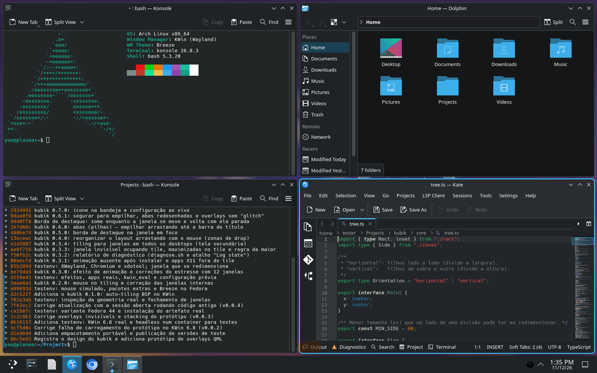
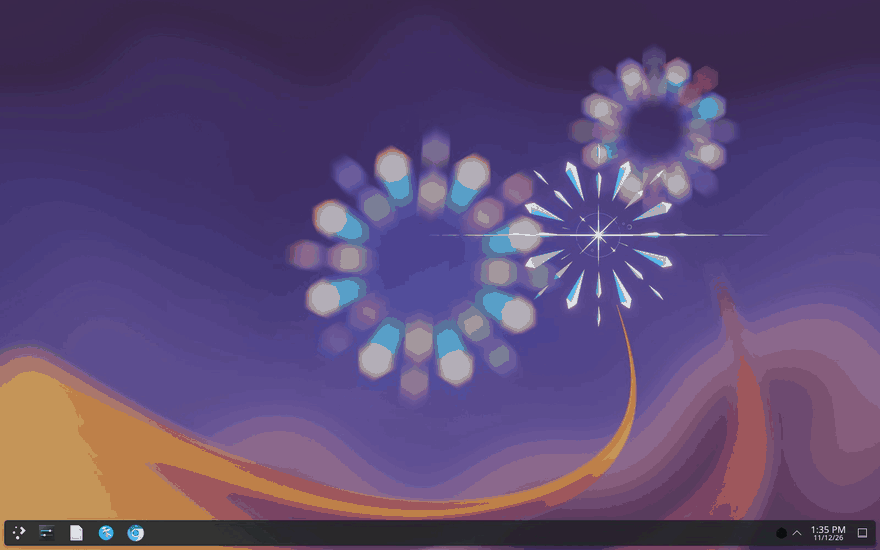
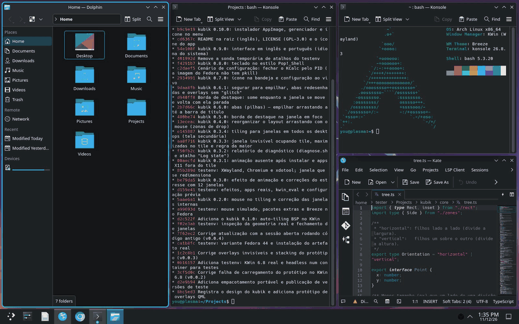
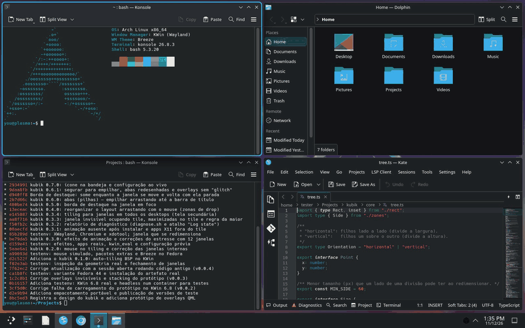
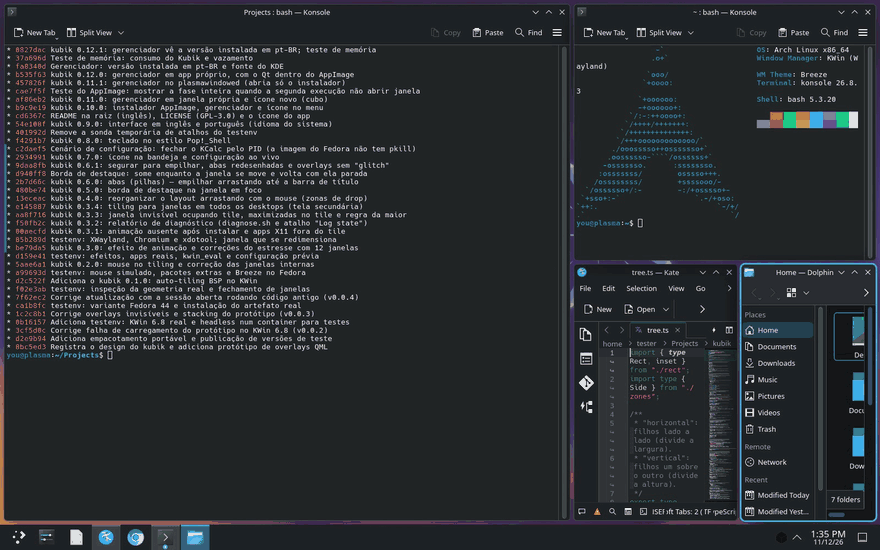
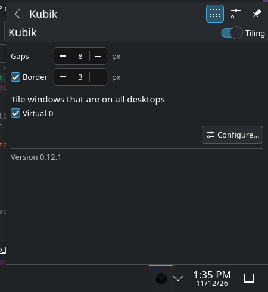
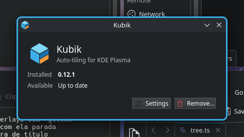

<p align="center"></p>

# Kubik

**Pop!_Shell-style auto-tiling for KDE Plasma 6** (Wayland and X11), as a KWin script plus a tray icon.

**[Website](https://dionatansimioni.github.io/kubik/) · [Download](https://github.com/dionatansimioni/kubik/releases)** · *Português: veja [kubik/README.md](kubik/README.md).*



## Features

- **Automatic BSP tiling:** each new window splits the largest one. One window fills the screen, two sit side by side, three become a half and two quarters. There is one tree per screen × virtual desktop.

  

- **Mouse:**
  - drag a window and drop it on another: the center swaps them, an edge splits there;
  - hold still over a window for ~0.8 s to **stack** them into tabs;
  - drag a border to resize both neighbors.

  

- **Keyboard:**

  | Keys | Action |
  |---|---|
  | Meta+arrows | focus the neighbor |
  | Meta+Shift+arrows | move or swap, also across screens |
  | Meta+Alt+arrows | resize |
  | Meta+O | rotate the split |
  | Meta+F | float the window |
  | Meta+M | monocle |
  | Meta+Y | turn tiling on/off |

  

- **Tabs (stacks)** with app icons. Cycle with Meta+Ctrl+Tab.

  

- **Highlight border** around the focused window, in the system accent color.
- **Smooth animations** (a companion KWin effect) with configurable duration and curve.
- **Tray icon:**
  - on/off, gaps, border, and per-screen "tile windows on all desktops";
  - exceptions (apps that always float), picked from the open apps;
  - animation settings;
  - update check against GitHub releases (can be turned off).

  

- English and Portuguese UI, following the system language.

## Install

Download `Kubik-<version>-x86_64.AppImage` from [Releases](https://github.com/dionatansimioni/kubik/releases), make it executable (right-click › Properties › Permissions) and double-click it. It's about 40 MB: the manager brings its own Qt, so it doesn't depend on the system's Qt or Plasma modules.

It opens the **Kubik manager**, a small window that shows what's installed and offers only what makes sense:




- **Install** when Kubik isn't there (the AppImage's version, or GitHub's if newer);
- **Update to X** when the AppImage or GitHub has a newer release;
- **Repair** when a component is missing;
- **Settings** (the tray icon's options) and **Remove…** when it's installed.

Installing adds the KWin script, the animation effect, the tray icon and a **Kubik** entry in the app menu, which opens the same manager. It also frees Meta+arrows from KDE's quick tile, and removing gives them back. On the very first install, log out and back in once, because KWin only discovers new effects at login. The manager tells you when that's needed.

Prefer the terminal?

```sh
tar xzf kubik-<version>.tar.gz && ./kubik-<version>/install.sh   # or: ./Kubik-<version>-x86_64.AppImage --install --yes
./kubik-<version>/uninstall.sh                                   # or: ./Kubik-<version>-x86_64.AppImage --uninstall --yes
```

## Development

- The core is TypeScript (`kubik/src`), bundled into QML.
- Tests run against a fake KWin (Vitest) and against a real headless KWin 6 in Docker (Arch, Fedora 44 and Debian 13 with Plasma 6.3); see `testenv/`.

```sh
scripts/node.sh kubik npm test           # unit tests (Node in a container)
python3 -m unittest discover -s tests    # everything, including real KWin
```

Design notes and lessons learned (in Portuguese) are in `docs/DESIGN.md`.

The screenshots and GIFs come from a real Plasma session recorded in the test environment: `scripts/showcase.sh`. The website lives in `site/` and is published by `.github/workflows/pages.yml`.

## License

GPL-3.0-or-later. See [LICENSE](LICENSE).
