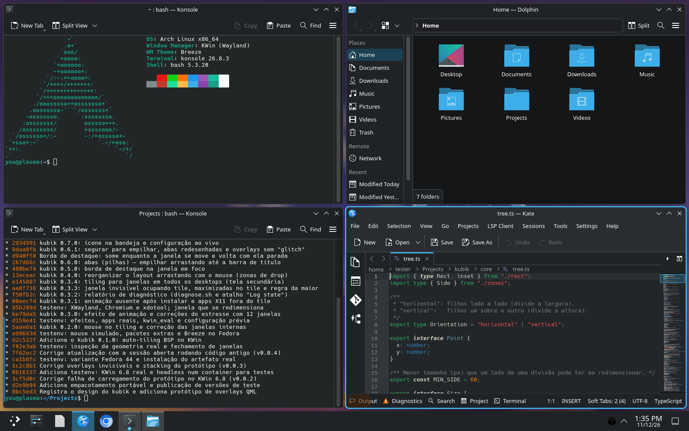
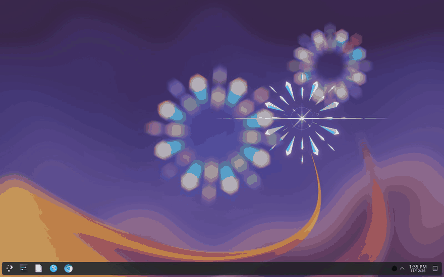
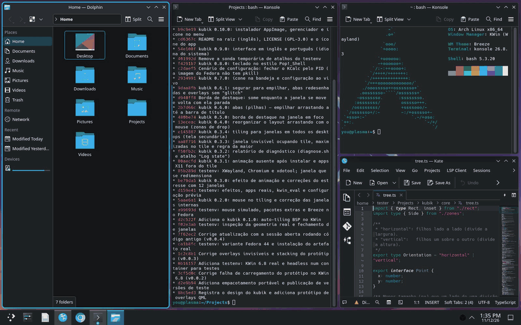
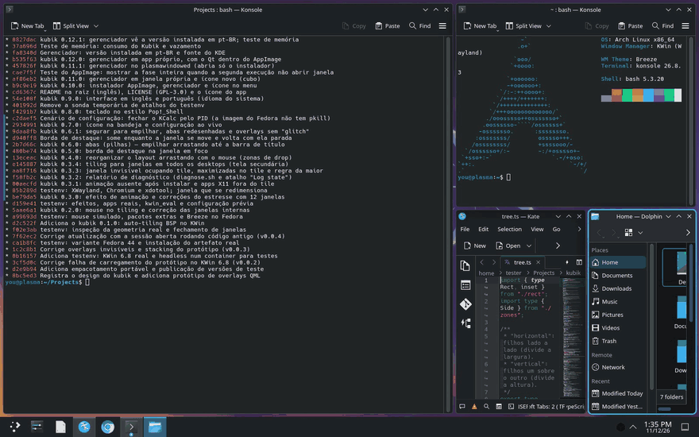
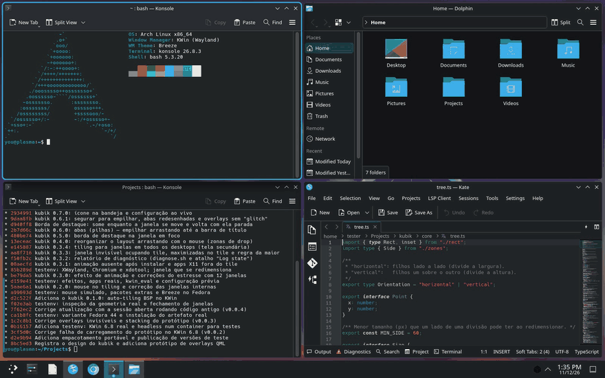
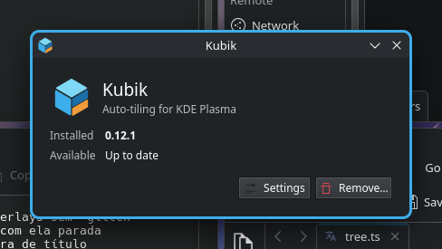

# kubik

Auto-tiling de janelas no estilo Pop!_Shell para o KDE Plasma 6.

**[Site](https://dionatansimioni.github.io/kubik/) · [Baixar](https://github.com/dionatansimioni/kubik/releases)**



| Janelas novas se organizam sozinhas | Arrastar: centro troca, borda divide |
|---|---|
|  |  |
| **Segurar sobre outra: abas** | **Teclado: foco, mover, redimensionar, girar, monóculo** |
|  |  |

## Instalar

Baixe a versão mais recente em **Releases** e escolha uma das formas:

- **Instalador (mais fácil):** `Kubik-<versão>-x86_64.AppImage`. Marque como executável (botão direito › Propriedades › Permissões) e abra com dois cliques: abre o gerenciador (abaixo), que oferece instalar. Pelo terminal: `--install --yes` ou `--uninstall --yes`. Tem ~40 MB porque traz o próprio Qt (6.8 LTS): não depende do Qt nem dos módulos do Plasma da máquina.
- **Pelo terminal:** `tar xzf kubik-<versão>.tar.gz && ./kubik-<versão>/install.sh`.
- **Só o script, pela interface:** Configurações do Sistema › Scripts do KWin › *Instalar de arquivo…* › `kubik-<versão>.kwinscript`, e marque **Kubik** (sem animações, bandeja e menu).

Para remover: **Remover…** no gerenciador, ou `./kubik-<versão>/uninstall.sh`.

### Gerenciador (o app Kubik)



Uma janela pequena, que abre pelo AppImage e pela entrada **Kubik** do menu. Mostra a versão instalada e a disponível, e só oferece o que faz sentido no momento:

| Situação | Botões |
|---|---|
| Nada instalado | **Instalar** (a versão do AppImage, ou a do GitHub se for mais nova) |
| Instalado e em dia | **Configurações**, **Remover…** |
| Versão mais nova no AppImage ou no GitHub | **Configurações**, **Remover…**, **Atualizar para X** |
| Falta algum componente | **Configurações**, **Remover…**, **Reparar** |

- Avisa quando as animações só ligam depois de sair e entrar na sessão, e quando o script está parado.
- **Configurações** abre o ícone da bandeja numa janela, ao lado do gerenciador.
- **Remover…** pede confirmação e tira tudo: script, efeito, bandeja, ícone, menu e atalhos (devolve os do KDE).
- É um app próprio, com o Qt dentro do AppImage: não depende do Qt nem dos módulos do Plasma da máquina, e segue as cores, a fonte e os ícones do Plasma. Se mesmo assim não abrir, o AppImage mostra um menu simples (kdialog) com as mesmas ações, e o motivo fica em `~/.cache/kubik/appimage.log`.
- Ao instalar, o AppImage se guarda em `~/.local/share/kubik/Kubik.AppImage` (com uma cópia do `uninstall.sh`), e a entrada do menu o abre. Atualizar pelo GitHub baixa o AppImage novo.

A bandeja também avisa de versão nova (ao iniciar e a cada 6 h; desliga em *Configurar… › Geral › Atualizações*) e tem o botão **Atualizar**.

## O que já funciona

- Janelas novas são organizadas em árvore BSP: a janela nova divide ao meio, pelo lado mais longo, a **maior** janela (no empate, a focada). Assim, 1 janela fica cheia, 2 ficam lado a lado, 3 ficam com metade + 2 quadrantes e 4 ficam em quadrantes. Minimizadas liberam o espaço.
- Janelas **em todos os desktops** entram no tiling do desktop visível e acompanham a troca de desktop. Com o plugin "Virtual desktops only on primary", isso inclui todas as janelas da tela secundária. Dá para desligar isso por tela, na bandeja.
- Uma janela que abre maximizada (ex.: o Chrome restaurando a sessão) entra no tile desmaximizada.
- Fechar ou minimizar uma janela devolve o espaço às vizinhas.
- Há uma árvore por tela × desktop virtual. Mover uma janela de tela ou de desktop a reorganiza no destino.
- Gaps de 4 px (ajustáveis na bandeja).
- Ficam flutuantes, fora do tiling: janelas internas do KWin (bordas e prévias de scripts), janelas auxiliares ocultas (fora da barra de tarefas e do Alt+Tab, ou com opacidade 0, como a ponte de vídeo do XWayland), diálogos, transientes, splash, janelas de tamanho fixo ou não redimensionáveis, janelas em alguns desktops (2 ou mais, mas não todos), tela cheia, algumas classes do Plasma (krunner, plasmashell, yakuake…) e as **exceções** escolhidas na bandeja.
- **Mouse:**
  - Arrastar uma janela pela barra de título mostra uma prévia translúcida de **onde ela vai ficar**. O que acontece depende de onde o cursor está sobre a janela-alvo:
    - **centro** (o terço do meio): as duas trocam de lugar, e uma segunda prévia, mais clara, mostra para onde vai a outra;
    - **perto de uma borda**: a janela-alvo é dividida e a arrastada entra daquele lado, o que reorganiza o layout. Exemplo: com 1 à esquerda e 2 e 3 à direita, soltar a 3 na metade de baixo da 1 deixa 1 e 3 à esquerda e a 2 com a direita inteira;
    - **segurar parado sobre a janela por ~0,8 s** (em qualquer ponto dela, inclusive em apps sem a barra de título do KDE, como o Chrome): as duas são **empilhadas em abas**. A prévia mostra um ícone de pilha. Mexer o cursor cancela. Soltar sobre a barra de abas de uma pilha empilha na hora.
  - Funciona também entre telas. Soltar num gap devolve a janela ao lugar.
  - Puxar a borda entre duas janelas redimensiona as duas ao vivo, e a proporção fica gravada na árvore.
- **Tamanhos mínimos:** as divisões cedem para cada app caber no mínimo dele (conteúdo + barra de título). Se a janela nova não couber em nenhuma divisão possível couber, ela fica flutuante, com o motivo no log.
- **Abas (pilhas):** as janelas de uma pilha dividem o mesmo tile, abaixo de uma barra de abas com a aba à vista na cor de destaque. A pilha se comporta como uma janela só: divide, troca e redimensiona inteira.
  - Cada aba mostra o ícone e o título do app. Clique numa aba para trazer a janela dela; Alt+Tab ou a barra de tarefas também funcionam.
  - O **×** da aba (ou o clique do meio) tira a janela da pilha e a devolve ao tiling, ao lado da pilha.
  - **Meta+Ctrl+Tab**: próxima aba; **Meta+Ctrl+Shift+Tab**: anterior. As teclas podem ser trocadas no ícone da bandeja, em Configurar… › Atalhos do tiling.
  - Também dá para tirá-la arrastando pela barra de título dela (abaixo da barra de abas) e soltando em outro lugar.
- **Borda de destaque:** um contorno de 3 px, na cor de destaque do sistema, envolve a janela em foco, seja ela do tiling ou uma janela flutuante comum. Ela nunca persegue a janela: enquanto a janela se move (arrasto com o mouse ou animação de layout), a borda some e é redesenhada com a janela já no lugar. Ao trocar o foco, muda na hora. Não aparece em diálogos, em tela cheia nem em janelas maximizadas.
- **Animações** (efeito *Kubik: animações*, instalado junto): as janelas deslizam e redimensionam suavemente quando o layout muda. Ficam de fora o arrasto com o mouse, a tela cheia e o maximizar, que têm animação própria do KWin. A velocidade global de animação do Plasma também vale.
- **Apps que mudam a própria geometria** (Chrome e apps Electron como o Podman Desktop, em X11, ao restaurar o tamanho da sessão anterior) voltam ao tile. Se o app insistir, ele fica flutuante e as outras janelas se reorganizam.
- **Teclado** (estilo Pop!_Shell):

  | Tecla | O quê |
  |---|---|
  | Meta+setas | foca a janela vizinha naquela direção (tiling ou flutuante, em qualquer tela; no empate, a usada por último) |
  | Meta+Shift+setas | troca a janela de lugar com a vizinha; em outra tela, entra ao lado dela; sem vizinha, vai para a tela daquele lado. Janela flutuante: quick tile do KDE |
  | Meta+Alt+setas | a divisa da janela anda na direção da seta (5% da tela): a da direita (ou de baixo); na borda, a do outro lado |
  | Meta+O | gira a divisão da janela (lado a lado ↔ um sobre o outro) |
  | Meta+F | flutua a janela em foco (volta ao tamanho de antes); de novo, ela volta ao tiling |
  | Meta+M | monocle: todas as janelas da tela ocupam a tela inteira; Meta+←/→ passam por elas |

  Essas teclas são, no KDE, do quick tile, de "mandar para outra tela" e de "trocar de janela por direção". Na primeira instalação, o `install.sh` guarda os atalhos do KDE, libera essas teclas e as dá ao Kubik; o `uninstall.sh` devolve tudo. Para trocar qualquer tecla, use o ícone da bandeja › Configurar… › **Atalhos do tiling**: cada ação mostra a tecla atual, um botão para voltar ao padrão, e há um "Restaurar todos os padrões". As mesmas ações aparecem em Configurações do Sistema › Atalhos › KWin (começam com "Kubik:"). O que você muda fica como está nas atualizações.
- **Meta+Y** liga e desliga o tiling. Ao religar, a árvore é reconstruída equilibrada. Ao desligar, as janelas voltam à posição e ao tamanho de antes.

## Ainda não

Layout guardado entre sessões. Ver `docs/DESIGN.md`.

## Desenvolvimento

O núcleo é TypeScript em `src/` e roda via `scripts/node.sh` (Node em container):

```sh
scripts/node.sh kubik npm test        # Vitest
scripts/node.sh kubik npm run build   # gera package/contents/ui/Kubik.qml
python3 -m unittest discover -s tests # tudo, inclusive o KWin real do testenv
```

- `src/core/`: a árvore BSP e a geometria, sem nenhuma dependência do KWin.
- `src/kwin/`: o controlador, que liga a árvore ao KWin por meio da interface mínima de `api.ts`. É testado contra o KWin falso de `test/fake-kwin.ts`.
- `src/effect/`: o efeito de animação. A decisão e o cálculo ficam em `morph.ts`, que é puro e testado; `main.ts` liga isso à API de efeitos. O resultado vai para `effect/`.
- `src/kwin/settings.ts`: as preferências do `kwinrc`, com padrões e limites. O script e a bandeja usam o mesmo leitor.
- `src/tray/logic.ts`: a lógica do ícone da bandeja (comandos, listas, validação, estado, releases do GitHub). O resultado vai para `tray/contents/code/logic.js`; o QML do plasmoide fica em `tray/contents/ui/`.
- `src/manager/logic.ts` + `manager/` (app Qt: `main.cpp`, `Main.qml`): o gerenciador (estado → ações, comandos, textos em en/pt). O `scripts/manager-app.sh` compila num container (Debian 13, Qt 6.8) e junta o Qt que vai dentro do AppImage. A lógica gerada vai para `manager/logic.js`.
- `src/qml/Kubik.qml`: o modelo em que o build embute o bundle.
- `package/`: o pacote do KWin. O `main.qml` é só um carregador.
- `scripts/appimage.sh` + `scripts/appimage/AppRun`: o instalador AppImage, feito do `.tar.gz` (runtime oficial do AppImage em versão fixa, conferido por sha256, + squashfs).

## Diagnóstico

Se o tiling se comportar de um jeito estranho, rode `./diagnose.sh` (vem no `.tar.gz`) na sessão onde o problema aparece. Ele gera `kubik-diagnostico-<data>.txt` com:

- as versões do Plasma e do KWin, as telas e os pacotes do kubik instalados;
- o estado interno do kubik: cada árvore, com o tile calculado e a geometria real de cada janela;
- todas as janelas que o KWin conhece;
- o log do kubik desde o login.

O estado também pode ir para o log pelo atalho "Kubik: registra o estado no log", que não tem tecla padrão.
